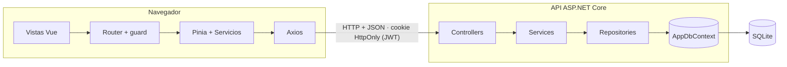
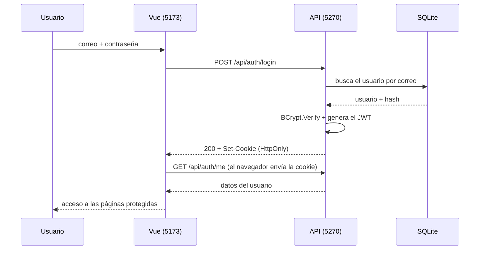

<div align="center">

# 📚 Bookcase App

**Catálogo de autores y libros con autenticación segura**
Vue.js + ASP.NET Core Web API conectados por una API REST


*Proyecto integrador de **Programación Web II** · UFHEC*

</div>

---

## ✨ ¿Qué es?

**Bookcase App** es una aplicación web donde un usuario crea su cuenta, inicia sesión y administra un catálogo de **autores** y **libros**. Cada libro pertenece a un autor, y el sistema protege tanto el acceso como la integridad de los datos.

El proyecto integra todo lo visto en la asignatura: un **frontend** en Vue.js, un **backend** en ASP.NET Core con C#, **persistencia** en base de datos y un esquema de **seguridad** completo con JWT, cookies `HttpOnly`, hashing de contraseñas y rutas protegidas.

## 🚀 Características

| | |
|---|---|
| 🔐 **Autenticación segura** | Registro e inicio de sesión con JWT guardado en una cookie `HttpOnly` |
| 🔑 **Contraseñas protegidas** | Hash con BCrypt (con sal), nunca se guardan en texto plano |
| 🛡️ **Rutas protegidas** | Guard en el router de Vue y `[Authorize]` en la API |
| 📖 **CRUD completo** | Crear, listar, editar y eliminar autores y libros |
| ✅ **Validación doble** | VeeValidate + Zod en el frontend, DataAnnotations en el backend |
| 🧩 **Arquitectura modular** | Cada módulo agrupa sus controladores, servicios y repositorios |
| 🌧️ **Login con personalidad** | Playa nocturna bajo la lluvia, tarjeta de cristal estilo burbuja |

## 🧰 Tecnologías

| Capa | Tecnologías |
|---|---|
| **Frontend** | Vue 3 · Vite · TypeScript · Vue Router · Pinia · Axios · VeeValidate · Zod |
| **Backend** | ASP.NET Core Web API (.NET 10) · C# · Entity Framework Core · JwtBearer · BCrypt.Net |
| **Base de datos** | SQLite (se crea sola al iniciar) |
| **Herramientas** | Git · GitHub · VS Code · dotnet CLI · npm |

## 🏗️ Arquitectura



### 🔐 Flujo de inicio de sesión



## ⚡ Inicio rápido

### Requisitos

- [.NET SDK 10](https://dotnet.microsoft.com/download)
- [Node.js](https://nodejs.org/) 20 o superior
- Git

### 1️⃣ Clonar el repositorio

```bash
git clone https://github.com/AbdielDJ/bookcase-app.git
cd bookcase-app
```

### 2️⃣ Backend

```bash
cd Backend
```

Crea el archivo `appsettings.Development.json` a partir de `appsettings.Development.example.json` y cambia `Jwt:Key` por una clave larga y aleatoria (mínimo 32 caracteres):

```json
{
  "Jwt": {
    "Key": "pon-aqui-una-clave-larga-y-aleatoria-de-al-menos-32-caracteres"
  }
}
```

Luego ejecuta:

```bash
dotnet run
```

> La base de datos `bookcase.db` y sus tablas se crean automáticamente al iniciar.
> La API queda en **http://localhost:5270**

### 3️⃣ Frontend

En otra terminal:

```bash
cd Frontend
copy .env.example .env      # en Mac/Linux: cp .env.example .env
npm install
npm run dev
```

Abre **http://localhost:5173**, crea una cuenta en *Registrarme* e inicia sesión. ¡Listo! 🎉

## 🗂️ Estructura del proyecto

```
bookcase-app/
├─ Backend/
│  ├─ Data/                  AppDbContext (EF Core)
│  ├─ Migrations/            Migraciones de la base de datos
│  ├─ Modules/
│  │  ├─ Auth/               Login, registro, JWT
│  │  ├─ Authors/            CRUD de autores
│  │  └─ Books/              CRUD de libros
│  │     ├─ Controllers/
│  │     ├─ Dtos/
│  │     ├─ Entities/
│  │     ├─ Repositories/
│  │     ├─ Services/
│  │     └─ BooksModule.cs
│  └─ Program.cs
│
└─ Frontend/
   └─ src/
      ├─ core/               Cliente axios y utilidades
      ├─ router/             Rutas y guard de autenticación
      ├─ shared/             Componentes y layouts reutilizables
      └─ modules/
         ├─ auth/            Login y registro
         ├─ authors/         CRUD de autores
         └─ books/           CRUD de libros
```

## 🔌 Endpoints de la API

| Método | Ruta | Descripción | Sesión |
|:---:|---|---|:---:|
| `POST` | `/api/auth/register` | Crear cuenta | ❌ |
| `POST` | `/api/auth/login` | Iniciar sesión (guarda la cookie) | ❌ |
| `POST` | `/api/auth/logout` | Cerrar sesión | ❌ |
| `GET` | `/api/auth/me` | Usuario actual | ✅ |
| `GET` `POST` | `/api/authors` | Listar y crear autores | ✅ |
| `GET` `PUT` `DELETE` | `/api/authors/{id}` | Ver, editar y eliminar un autor | ✅ |
| `GET` `POST` | `/api/books` | Listar y crear libros | ✅ |
| `GET` `PUT` `DELETE` | `/api/books/{id}` | Ver, editar y eliminar un libro | ✅ |

## 🔒 Seguridad

- **Cookie `HttpOnly`**: JavaScript no puede leer el token, así que un ataque XSS no puede robarlo.
- **BCrypt**: las contraseñas se guardan como hash con sal; el hash no se puede revertir.
- **Protección en dos capas**: el guard de Vue mejora la experiencia y `[Authorize]` protege los datos de verdad.
- **CORS con credenciales**: solo el origen del frontend puede consultar la API.
- **Mensajes de error genéricos**: el login no revela si un correo existe o no.
- **Secretos fuera del repositorio**: la clave del JWT y la base de datos local están en `.gitignore`.

## 🧪 Prueba rápida

1. Regístrate con una contraseña como `Prueba123` (mínimo 8 caracteres, una mayúscula y un número).
2. Inicia sesión: deberías llegar a `/books`.
3. Crea un autor y luego un libro asociado a ese autor.
4. Intenta eliminar el autor: el sistema lo impide mientras tenga libros.
5. Cierra sesión y abre `/books`: te redirige al login.

## 🛠️ Solución de problemas

| Problema | Solución |
|---|---|
| `BackEnd.exe` en uso al compilar | Ya hay una instancia corriendo: ciérrala con `Ctrl + C` |
| `PendingModelChangesWarning` al iniciar | Crea la migración: `dotnet ef migrations add NombreNuevo -o Migrations` |
| Falta `Jwt:Key` al iniciar | Crea `appsettings.Development.json` desde el archivo de ejemplo |
| El frontend no conecta con la API | Revisa `VITE_API_URL` en `.env` y reinicia `npm run dev` |
| `404` en `http://localhost:5270/` | Es normal: la API vive bajo `/api` |

## 🔭 Mejoras futuras

- [ ] Separar los datos por usuario (`UserId` en autores y libros)
- [ ] Roles de administrador y usuario
- [ ] Paginación y búsqueda en las listas
- [ ] Refresh tokens y revocación de sesiones
- [ ] Pruebas automatizadas

## 👨‍💻 Autor

**Abdiel de Jesús**
Estudiante de la **Universidad UFHEC**
Asignatura: Programación Web II · Profesor: **Jaime Vilorio Green**

---

<div align="center">

Hecho con 💙 y mucha lluvia 🌧️

</div>
